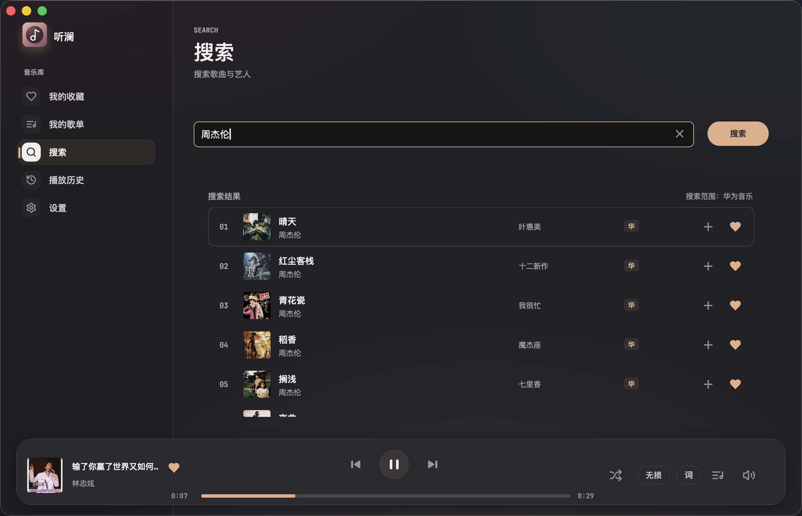
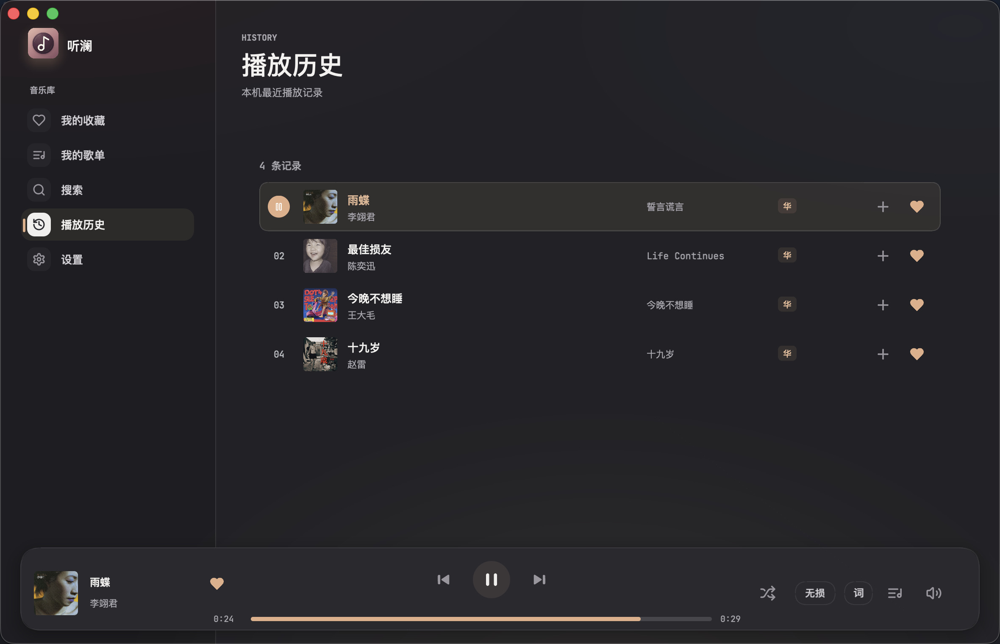

<p align="center">
  
</p>
<h1 align="center">听澜 · Tinglan</h1>
<p align="center"><strong>把喜欢的歌，留在桌面上。</strong></p>
<p align="center">华为音乐的收藏与歌单，配上一扇属于自己的听歌窗口。</p>
<p align="center">
  <a href="#听歌也看歌词">听歌体验</a> ·
  <a href="#换一种心情">界面一览</a> ·
  <a href="#开始使用">开始使用</a> ·
  <a href="#社区">社区</a>
</p>


听澜是一款用 **Go + Viva** 构建的原生桌面音乐客户端。登录自己的华为账号，就能在电脑上浏览音乐库、播放喜欢的歌，不需要手机充当播放器。

支持**外置音源插件**：在「设置 → 音源 → 导入插件」选择目录，启用后按插件声明的能力提供搜索、播放解析或收藏导入。华为音源随应用预置；第三方插件以独立进程运行，脚本插件需用户自备运行时。想编写自己的音源，从[插件开发指南：10 分钟做出可搜索的音源](docs/PLUGIN_GUIDE.md)开始。请使用包含该入口的构建，插件支持不代表各平台已经完成实机验收。

轻点封面，展开歌词；再点一次，回到音乐库。工作时让播放器安静地浮在底部，想认真听一首歌时，就把封面和歌词留在眼前。

> 非官方、实验性项目，与华为无隶属或合作关系。内置华为源仅播放账号已有权益允许的原音源；外置音源同样须遵守对应平台的服务条款与会员、地域限制，不以其它平台资源绕过限制。完整说明见[免责声明与使用边界](docs/DISCLAIMER.md)。

## 听歌，也看歌词

**有些歌想跟着唱，有些歌想读懂。**

当前唱到的句子保持高亮，提供逐字时间信息的歌词还会逐字点亮。歌词源附带的音译或译文会显示在原句下方；听澜仅负责排版展示，不生成音译或翻译。

- **顺着歌走，也能自己翻。** 默认自动跟随；手动滚动后停留 5 秒，无操作便回到当前歌词。
- **保留你的歌词版本。** 支持导入本地 LRC / TXT，也能按歌曲调整时间偏移。
- **听歌不用反复切窗口。** 应用内空格暂停或继续，托盘与系统媒体控制方便随手操作。
- **常用操作，随点随开。** 音质、播放顺序、音量使用上浮菜单，播放队列打开就定位到当前歌曲。

<details>
<summary><strong>看看双语歌词 · 原文与翻译一起读</strong></summary>


</details>

## 换一种心情

从明亮到深沉，**12 款预设主题**让音乐库、悬浮播放器和歌词页保持同一种气氛。字体可以从本机已安装字体中搜索选择，字号也能按习惯调整。


目前支持浏览已有歌单，不提供创建歌单或向歌单添加歌曲。搜索结果随滚动继续加载；播放搜索到的歌曲会加入当前队列，不替换原有列表。

**熟悉的歌，都有位置。** 收藏、歌单、搜索和播放历史连在一起。想找一首老歌，搜歌名或艺人；想接着昨天听，打开历史就好。

| 搜索喜欢的歌 | 留住自己的歌单 |
| --- | --- |
|  |  |

<details>
<summary><strong>播放历史 · 找回刚刚听过的那一首</strong></summary>



</details>

截图记录的是此次调整前的界面；搜索页的数量、播放全部，以及歌单页的创建入口现已移除。

以上均为 **macOS 原生应用的真实窗口截图**，于 2026-10-30 经用户授权截取。封面、歌词等内容的权利归各自权利人所有，图片仅用于展示应用界面。

## 开始使用

听澜仍在持续打磨。目前以 **macOS Apple Silicon** 为主要开发与实际使用环境，本页截图也来自这一版本。Windows / Linux 已有适配代码与构建脚本，尚未完成实机验收。

可从 [Latest Release](https://github.com/talongao/tinglan/releases/latest) 下载 macOS 或 Windows 测试安装包，也可从源码构建。测试包没有开发者证书签名或公证，尚不是正式发行版。原生界面、播放与构建工具链全部由 Go 实现，不依赖 Electron 或 Node.js；外置脚本插件的解释器需另行安装。当前华为插件通过宿主内嵌窗口自动接收回调：macOS 使用 WKWebView，Windows 使用 WebView2 登录窗口（需要 Microsoft Edge WebView2 Runtime，仍待实机验证），无需手动复制回调链接。

<details>
<summary><strong>从源码启动</strong></summary>

准备 Go 1.27.3+ 和本平台 C 编译工具；macOS 需要 Xcode Command Line Tools。构建和工具链全部由 Go 完成，不再需要 Node.js 或 npm。在 `native/` 下运行：

```sh
go run ./cmd/tinglan-tool start
```

构建本机原生程序：

```sh
go run ./cmd/tinglan-tool build
```

macOS 应用构建：

```sh
go run ./cmd/tinglan-tool mac-app
```

离线界面回归（无头 Viva，不需要浏览器驱动）：

```sh
go run ./cmd/tinglan-tool ui-check
```

日常开发在 `develop`：到 Actions 手动选择 macOS Apple Silicon、macOS Intel 或 Windows x64 构建，试用包保留在 Artifacts，不发布 Release。`main` 仅接受通过检查的 PR；合并后自动构建三个版本，全部成功才发布到 [Latest Release](https://github.com/talongao/tinglan/releases/latest)。发布标签带独立构建编号，旧版本不会被覆盖。Windows 安装包仍为未完成实机验收的测试构建；Linux 暂不打包。

平台依赖、打包与测试方式见[原生开发说明](native/README.md)。项目已移除旧 Electron 客户端，默认入口为原生版。

</details>

## 关于账号与音乐

使用自己的华为账号登录，标准与无损音质以账号权益及服务端实际返回为准。听澜不提供音频下载、解密或其他平台音源替换。

登录状态按你的选择保存在本机应用数据目录，不访问系统钥匙串。凭据保护依赖操作系统用户隔离与文件权限；音乐会话不自动续期，确认失效后需要重新登录。

在线歌词优先使用服务端返回的内容。可选的第三方歌词匹配仅查询歌词，不提供音源；匹配时会发送歌名、艺人等曲目信息，不发送账号凭据，可在设置中关闭。找不到合适的歌词时，也可以自己导入。

服务接口、歌词匹配和不同系统的表现仍可能存在差异。具体的验证范围与待办见[实现状态](docs/IMPLEMENTATION_STATUS.md)，不以截图或编译成功代替完整验收。

## 接下来

**Windows 可用性验证**仍是发布门槛；多源收藏已纳入 roadmap，外置音源插件基础已实现，网易云适配器尚未实现。测试和修复在 `develop` 进行，按需试用包从 Actions Artifacts 获取；经确认合入 `main` 的测试版本通过 Release 分发。

重点验证安装与启动、登录与会话恢复、音乐库与搜索、MP3/FLAC 播放及拖动进度、歌词、托盘续播与系统媒体控制。CI 构建成功只是起点，不代表这些使用体验已经验收。

## 一起把听澜做好

欢迎带着使用感受来提 [Issue](https://github.com/talongao/tinglan/issues)，也欢迎修复问题、改善排版和可访问性、补充跨平台验证的 PR。

反馈时写清系统版本、复现步骤和预期表现；截图请避开账号信息。不要提交 Token、Cookie、授权码或私人数据。音源扩展须遵守 roadmap 与平台条款，项目不接受绕过付费限制、音频解密或未经授权的资源替换。

开发资料：[原生开发说明](native/README.md) · [音源插件开发指南](docs/PLUGIN_GUIDE.md) · [实现状态](docs/IMPLEMENTATION_STATUS.md) · [迁移记录](docs/VIVA_MIGRATION.md) · [接口契约](docs/API_CONTRACT.md) · [验证记录](docs/authorized-feature-validation.md)

## 社区

感谢 [LINUX DO](https://linux.do/) 社区。

愿这里也能遇到喜欢折腾桌面、认真听歌的朋友。

## 开源与致谢

听澜使用 [Viva](https://github.com/vivaui/viva) 构建原生界面，界面图标基于 [Lucide](https://lucide.dev/)（ISC）。应用图标的许可与归属保留在 [icon.LICENSE.txt](build/icon.LICENSE.txt)。感谢这些开源项目。

代码采用 **AGPL-3.0-only**，详见 [LICENSE](LICENSE) 与 [NOTICE](NOTICE)。许可证仅覆盖代码，不授予音乐内容、商标或服务接口的使用权。登录所用 OAuth 应用身份不属于本项目；公开分发或商业使用前，请阅读[完整免责声明](docs/DISCLAIMER.md)并自行核查必要授权。
